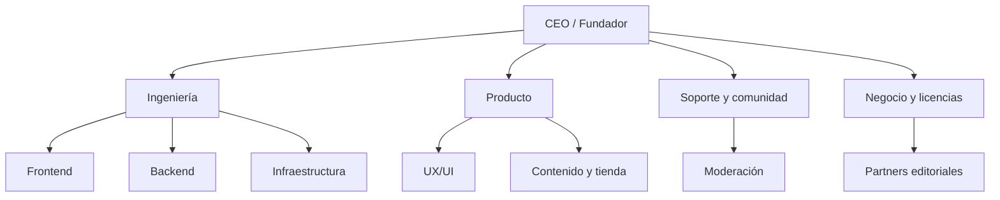

# 01 · Análisis y documentación inicial (RA1)

## 1. Sector y empresas (CE 1a, 1b)

Sector: **plataformas de juego de rol online / virtual tabletop (VTT)**. Empresas relevantes:

| Empresa / producto | Características organizativas | Producto o servicio |
|---|---|---|
| Roll20 (The Orr Group) | Empresa pequeña/mediana, equipo distribuido, modelo SaaS | VTT con fichas, mapas, dados y tienda de contenido |
| Foundry VTT | Empresa pequeña, licencia única de pago | VTT autoalojable, muy extensible por módulos |
| Fantasy Grounds (SmiteWorks) | Empresa pequeña, licencia perpetua + suscripción | VTT con automatización de reglas y contenido oficial |
| D&D Beyond (Wizards of the Coast / Hasbro) | Gran corporación, integración con marca | Gestión de fichas y compendio digital de D&D |
| Owlbear Rodeo | Proyecto pequeño/independiente | VTT minimalista, gratuito, centrado en mapas |
| Tabletop Simulator (Berserk Games) | Estudio indie | Simulador 3D de mesa física |

**Empresa tipo: Roll20 (The Orr Group).** Organigrama simplificado:

Funciones: Ingeniería desarrolla y mantiene la plataforma; Producto define hoja de ruta y UX; Soporte atiende usuarios y moderación; Negocio gestiona licencias con editoriales y tienda.

## 2. Necesidades y oportunidades (CE 1c, 1d)

Necesidades priorizadas (criterio: frecuencia de aparición en foros/comunidades y encuestas a jugadores):

1. Jugar a distancia con amigos sin perder la inmersión.
2. Mantener la memoria de la campaña entre sesiones (notas, eventos, personajes).
3. Gestión sencilla de fichas y tiradas sin automatización excesiva.
4. Acceso desde navegador sin instalación.
5. Posibilidad de jugar en solitario (máster IA).

Oportunidad de negocio: el mercado de VTT creció con el auge del rol online; una gran parte de las partidas de rol se juegan ya online. Un nicho claro es la combinación de VTT ligero + memoria de campaña + máster con IA para jugadores sin grupo.

## 3. Tipo de proyecto elegido (CE 1e)

Proyecto elegido: **aplicación web de partidas de rol en tiempo real con máster IA**, frente a alternativas como un VTT completo tipo Roll20 (demasiado alcance) o un simple gestor de fichas (insuficiente). Se opta por un núcleo completo (fichas, dados, tablero, memoria, tiempo real) más un máster con IA como extensión, equilibrando alcance y tiempo disponible.

## 4. Requisitos y restricciones (CE 1f)

| ID | Requisito | Tipo (funcional / no funcional / restricción) | Cómo se verifica |
|---|---|---|---|
| RF-01 | El usuario puede crear y editar una ficha de personaje | funcional | Prueba manual: crear ficha y comprobar persistencia |
| RF-02 | El usuario puede realizar tiradas de dados y ver el resultado compartido | funcional | Prueba: tirada visible para todos los jugadores en <1 s |
| RF-03 | Los jugadores comparten un tablero con posiciones de personajes | funcional | Prueba: movimiento visible en tiempo real |
| RF-04 | El sistema guarda y recupera la memoria de la campaña entre sesiones | funcional | Prueba: cerrar y reabrir partida y comprobar datos |
| RF-05 | Varios jugadores interactúan en tiempo real sobre la misma partida | funcional | Prueba con 3+ clientes conectados |
| RF-06 | Un máster con IA conduce la partida en modo un jugador | funcional | Prueba: partida completa con IA como máster |
| RNF-01 | Las acciones en tiempo real se reflejan en menos de 1 s | no funcional | Medición con timestamps en cliente |
| RNF-02 | La interfaz es usable en navegador de escritorio | no funcional | Prueba manual en Chrome/Firefox |
| RNF-03 | Los datos se persisten en base de datos | no funcional | Reinicio del servidor mantiene datos |
| REST-01 | Plazo de entrega: primera versión mínima antes del 31-03-2027 | restricción | Calendario del proyecto |
| REST-02 | Tecnologías: React, WebSockets, BD vectorial, API LLM, Docker | restricción | Stack definido en el repo |
| REST-03 | No se usan datos personales reales | restricción | Revisión de datos de ejemplo |

### Matriz de trazabilidad

| Objetivo | Requisito | Caso de uso | Pantalla o endpoint | Prueba o indicador |
|---|---|---|---|---|
| OBJ-01 Crear y editar una ficha de personaje en menos de 3 pasos, comprobado con prueba manual | RF-01 | CU-01 Crear ficha | /fichas | P-01 |
| OBJ-02 Jugar en tiempo real: tiradas y movimientos visibles en todos los clientes en menos de 1 s (medido con timestamps) | RF-02 | CU-02 Tirar dados | WebSocket /dados | P-02 |
| OBJ-02 Jugar en tiempo real: tiradas y movimientos visibles en todos los clientes en menos de 1 s (medido con timestamps) | RF-03 | CU-03 Mover ficha | /tablero | P-03 |
| OBJ-02 Jugar en tiempo real: tiradas y movimientos visibles en todos los clientes en menos de 1 s (medido con timestamps) | RF-05 | CU-05 Sincronizar | WebSocket | P-05 |
| OBJ-02 Jugar en tiempo real: tiradas y movimientos visibles en todos los clientes en menos de 1 s (medido con timestamps) | RNF-01 | CU-05 Sincronizar | WebSocket | P-05 |
| OBJ-02 Jugar en tiempo real: tiradas y movimientos visibles en todos los clientes en menos de 1 s (medido con timestamps) | RNF-02 | CU-01 a CU-05 | Interfaz web | P-07 |
| OBJ-03 Recuperar la memoria de la campaña al reabrir la partida (sí/no) | RF-04 | CU-04 Guardar/recuperar | /campana | P-04 |
| OBJ-03 Recuperar la memoria de la campaña al reabrir la partida (sí/no) | RNF-03 | CU-04 Guardar/recuperar | Base de datos | P-08 |
| OBJ-04 Conducir una partida de 30 minutos en solitario con el máster IA (sí/no) | RF-06 | CU-06 Jugar con IA | /ia-master | P-06 |

## 5. Obligaciones fiscales, laborales y de prevención (CE 1g)

| Obligación | Por qué le toca | Norma (con enlace) | Estado |
|---|---|---|---|
| IVA, si la web llegara a facturar | Hoy por hoy no facturaría la web, pero si en algún momento llegara a convertirse en un negocio, quien presta el servicio pasará a ser empresario o profesional. Se apoya en el apartado de sujetos pasivos: «las personas físicas o jurídicas que tengan la condición de empresarios o profesionales y realicen las entregas de bienes o presten los servicios sujetos al Impuesto» | BOE-A-1992-28740 — https://www.boe.es/buscar/act.php?id=BOE-A-1992-28740 | leído solo el apartado de sujetos pasivos, 2026-11-23 |
| Contratación de personal, si la hubiera | No contrataré a nadie, así que hoy no me toca; si contratara a alguien, prestaría servicios retribuidos por cuenta ajena. La norma dice: «Esta ley será de aplicación a los trabajadores que voluntariamente presten sus servicios retribuidos por cuenta ajena y dentro del ámbito de organización y dirección de otra persona, física o jurídica, denominada empleador o empresario» | BOE-A-2015-11430 (Estatuto de los Trabajadores) — https://www.boe.es/buscar/act.php?id=BOE-A-2015-11430 | leído, 2026-11-24 |
| Prevención de riesgos laborales (trabajo con pantallas) | No contrataré a nadie, así que hoy no me toca; si una persona trabajara habitualmente con pantallas, le aplicaría esta norma. Dice: «Trabajador: cualquier trabajador que habitualmente y durante una parte relevante de su trabajo normal utilice un equipo con pantalla de visualización» | PANTALLAS DE VISUALIZACIÓN: REAL DECRETO 488/1997 SOBRE DISPOSICIONES MÍNIMAS DE SEGURIDAD Y SALUD RELATIVAS AL TRABAJO CON EQUIPOS QUE INCLUYEN PANTALLAS DE VISUALIZACIÓN — https://www.insst.es/documents/d/portal-insst/tema-65-pantallas-de-visualizacion-de-datos | leído, 2026-11-24 |
| Protección de datos de los usuarios | La aplicación guardará nombre de usuario, correo y contraseña para iniciar sesión, que son datos personales. La norma define dato personal como «toda información sobre una persona física identificada o identificable (el interesado)» | RGPD, Reglamento (UE) 2016/679 — https://www.aepd.es/documento/reglamento-ue-2016-679-consolidado.pdf | leído, 2026-11-24 |

**Lo que no pude comprobar**

- Las normas del IVA y del Estatuto se han leído solo en el apartado indicado en la tabla, no completas.
- Los PDF del INSST y del RGPD no los he abierto yo: los ha leído la persona.
- No hay actividad económica, así que las obligaciones fiscal y laboral son para el caso de que la web llegue a ser un negocio.
- No se ha revisado si la aplicación cumple de verdad el RGPD; solo se nombra la norma.

## 6. Ayudas y subvenciones (CE 1h)

**Ayuda elegida: ayudas a la transformación Digital 2026** (Agencia de Ciencia, Competitividad e Innovación Asturiana / SEKUENS).

- **Convocatoria:** Resolución de 20 de marzo de 2026, BDNS **894735** — https://www.infosubvenciones.es/bdnstrans/ge/es/convocatoria/894735
- **Quién puede pedirla:** pymes y empresarios individuales con centro de trabajo en Asturias, de los sectores industrial, servicios industriales (incluida logística) y construcción. Los autónomos deben contar con un empleado, computando el propio autónomo. Quedan excluidas comunidades de bienes, sociedades civiles, asociaciones, fundaciones, entidades sin ánimo de lucro y empresas en disolución.
- **Qué cubre:** proyectos de inversión en el Principado que implanten y desarrollen soluciones en el ámbito de la industria 4.0.
- **Cuánto:** 1.500.000 € como cuantía máxima de la convocatoria en 2026, ampliables en 750.000 €. El extracto no da un importe por proyecto.
- **Plazo:** desde el día siguiente a la publicación del extracto hasta las 14:00 del 05/05/2026 (hora peninsular). **Cerrada** a 2026-11-24.
- **Cómo se solicita:** los modelos normalizados de solicitud y cuenta justificativa están en el portal de la Agencia, `www.sekuens.es`.
- **Bases reguladoras:** Resolución de 02/07/2024 (BOPA n.º 134, 10/07/2024); enlace pendiente, `sin leer`.
- **Estado de la fuente:** extracto leído el 2026-11-24.
- **Encaje con mi proyecto:** es una ayuda de digitalización, pero hoy no encaja: el proyecto es académico y personal, sin centro de trabajo en Asturias ni actividad industrial.

**Lo que no pude comprobar**

- No se han abierto las bases reguladoras; los datos vienen del extracto publicado en la BDNS.
- El extracto no detalla gastos subvencionables concretos ni la cuantía por beneficiario.
- No se ha comprobado si existe otra convocatoria abierta a fecha 2026-11-24.

## 7. Guion de trabajo (CE 1i)

| Fase | Fechas | Tareas principales | Responsable | Hito |
|---|---|---|---|---|
| 1 Análisis | 6-nov a 26-nov-2026 | Completar la documentación de inicio y el análisis (apartados 1–6 de `01-analisis.md`); revisar los requisitos RF/RNF/REST y la matriz de trazabilidad | yo; tutor (revisión) | H1 26-nov-2026 |
| 2 Diseño | 26-nov a 10-dic-2026 | Diseñar la arquitectura de la aplicación (React, Node/Express, WebSockets y base de datos vectorial); diseñar la interfaz de fichas, tablero y chat; diseñar el modelo de datos de la memoria de campaña | yo | — |
| 3 Planificación | 10-dic-2026 a 21-ene-2027 | Planificar las entregas y preparar el tablero de seguimiento en GitHub Projects; registrar las decisiones técnicas (stack, base de datos vectorial, API del LLM) en `decisiones/`; preparar el plan de pruebas de los requisitos RF y RNF | yo; tutor (revisión) | H2 21-ene-2027 |
| 4 Implementación | 21-ene a 31-mar-2027 | Implementar fichas, tiradas de dados y tablero compartido (RF-01 a RF-03); implementar la memoria de campaña persistente y la sincronización en tiempo real (RF-04 y RF-05); integrar el máster con IA en modo un jugador (RF-06) | yo | — |
| 5 Pruebas | 1-abr a 23-abr-2027 | Ejecutar las pruebas funcionales de los requisitos RF-01 a RF-06; medir la latencia en tiempo real (<1 s) y comprobar la persistencia de la memoria tras reiniciar; registrar las incidencias encontradas y corregirlas | yo | — |
| 6 Despliegue | 26-abr a 7-may-2027 | Preparar el despliegue con Docker y la configuración del entorno (sin claves reales en el repositorio); publicar la aplicación y comprobar que se abre en un navegador; terminar la documentación final y preparar la entrega | yo; tutor (revisión) | H3 7-may-2027 |
| 7 Seguimiento, control y cierre | 11-feb a 18-jun-2027 | Revisar el avance semanal y actualizar `docs/registro-tutoria.md`; controlar que el tablero de tareas esté al día; cerrar la documentación y preparar la entrega final | yo | — |

Tablero de seguimiento: GitHub Projects del repositorio.

## 8. Glosario

| Término | Definición | Sinónimos que NO uso |
|---|---|---|
| VTT (Virtual Tabletop) | Plataforma online para jugar rol con mapas y fichas | mesa virtual (evitar) |
| Ficha de personaje | Hoja con atributos, habilidades y equipo del personaje | hoja de personaje |
| Campaña | Serie de sesiones de juego conectadas por una historia | partida larga |
| Máster (MJ) | Persona o IA que narra y dirige la partida | director de juego |
| Memoria de campaña | Registro persistente de eventos y estado de la partida | historial |
| WebSockets | Protocolo de comunicación bidireccional en tiempo real | socket (ambiguo) |

---

## Criterios de evaluación de este documento (RA1, texto literal)

- **1a)** Se han clasificado las empresas del sector por sus características organizativas y el tipo de producto o servicio que ofrecen.
- **1b)** Se han caracterizado las empresas tipo indicando la estructura organizativa y las funciones de cada departamento.
- **1c)** Se han identificado las necesidades más demandadas a las empresas.
- **1d)** Se han valorado las oportunidades de negocio previsibles en el sector.
- **1e)** Se ha identificado el tipo de proyecto requerido para dar respuesta a las demandas previstas.
- **1f)** Se han determinado las características específicas requeridas al proyecto.
- **1g)** Se han determinado las obligaciones fiscales, laborales y de prevención de riesgos y sus condiciones de aplicación.
- **1h)** Se han identificado posibles ayudas o subvenciones para la incorporación de nuevas tecnologías de producción o de servicio que se proponen.
- **1i)** Se ha elaborado el guión de trabajo que se va a seguir para la elaboración del proyecto.