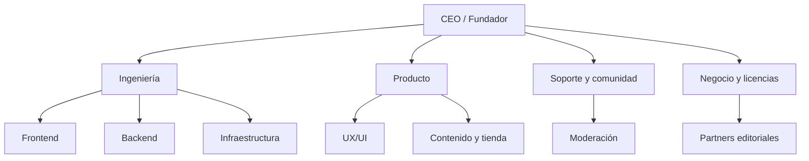

# 01 · Análisis y documentación inicial (RA1)

## 1. Sector y empresas (CE 1a, 1b)

Sector: **plataformas de juego de rol online / virtual tabletop (VTT)**. Empresas relevantes:

| Empresa / producto | Características organizativas | Producto o servicio |
|---|---|---|
| Roll20 (The Orr Group) | Empresa pequeña/mediana, equipo distribuido, modelo SaaS | VTT con fichas, mapas, dados y tienda de contenido |
| Foundry VTT | Empresa pequeña, licencia única de pago | VTT autoalojable, muy extensible por módulos |
| Fantasy Grounds (SmiteWorks) | Empresa pequeña, licencia perpetua + suscripción | VTT con automatización de reglas y contenido oficial |
| D&D Beyond (Wizards of the Coast / Hasbro) | Gran corporación, integración con marca | Gestión de fichas y compendio digital de D&D |
| Owlbear Rodeo | Proyecto pequeño/independiente | VTT minimalista, gratuito, centrado en mapas |
| Tabletop Simulator (Berserk Games) | Estudio indie | Simulador 3D de mesa física |

**Empresa tipo: Roll20 (The Orr Group).** Organigrama simplificado:

Funciones: Ingeniería desarrolla y mantiene la plataforma; Producto define hoja de ruta y UX; Soporte atiende usuarios y moderación; Negocio gestiona licencias con editoriales y tienda.

## 2. Necesidades y oportunidades (CE 1c, 1d)

Necesidades priorizadas (criterio: frecuencia de aparición en foros/comunidades y encuestas a jugadores):

1. Jugar a distancia con amigos sin perder la inmersión.
2. Mantener la memoria de la campaña entre sesiones (notas, eventos, personajes).
3. Gestión sencilla de fichas y tiradas sin automatización excesiva.
4. Acceso desde navegador sin instalación.
5. Posibilidad de jugar en solitario (máster IA).

Oportunidad de negocio: el mercado de VTT creció con el auge del rol online; se estima que más del 50 % de las partidas de rol se juegan ya online (fuentes: informes de la industria y comunidades como Reddit r/rpg). Un nicho claro es la combinación de VTT ligero + memoria de campaña + máster con IA para jugadores sin grupo.

## 3. Tipo de proyecto elegido (CE 1e)

Proyecto elegido: **aplicación web de partidas de rol en tiempo real con máster IA**, frente a alternativas como un VTT completo tipo Roll20 (demasiado alcance) o un simple gestor de fichas (insuficiente). Se opta por un núcleo completo (fichas, dados, tablero, memoria, tiempo real) más un máster con IA como extensión, equilibrando alcance y tiempo disponible.

## 4. Requisitos y restricciones (CE 1f)

| ID | Requisito | Tipo (funcional / no funcional / restricción) | Cómo se verifica |
|---|---|---|---|
| RF-01 | El usuario puede crear y editar una ficha de personaje | funcional | Prueba manual: crear ficha y comprobar persistencia |
| RF-02 | El usuario puede realizar tiradas de dados y ver el resultado compartido | funcional | Prueba: tirada visible para todos los jugadores en <1 s |
| RF-03 | Los jugadores comparten un tablero con posiciones de personajes | funcional | Prueba: movimiento visible en tiempo real |
| RF-04 | El sistema guarda y recupera la memoria de la campaña entre sesiones | funcional | Prueba: cerrar y reabrir partida y comprobar datos |
| RF-05 | Varios jugadores interactúan en tiempo real sobre la misma partida | funcional | Prueba con 3+ clientes conectados |
| RF-06 | Un máster con IA conduce la partida en modo un jugador | funcional | Prueba: partida completa con IA como máster |
| RNF-01 | Las acciones en tiempo real se reflejan en menos de 1 s | no funcional | Medición con timestamps en cliente |
| RNF-02 | La interfaz es usable en navegador de escritorio | no funcional | Prueba manual en Chrome/Firefox |
| RNF-03 | Los datos se persisten en base de datos | no funcional | Reinicio del servidor mantiene datos |
| REST-01 | Plazo de entrega: primera versión mínima antes del 31-03-2027 | restricción | Calendario del proyecto |
| REST-02 | Tecnologías: React, WebSockets, BD vectorial, API LLM, Docker | restricción | Stack definido en el repo |
| REST-03 | No se usan datos personales reales | restricción | Revisión de datos de ejemplo |

### Matriz de trazabilidad

| Objetivo | Requisito | Caso de uso | Pantalla o endpoint | Prueba o indicador |
|---|---|---|---|---|
| OBJ-01 Crear y editar una ficha de personaje en menos de 3 pasos, comprobado con prueba manual | RF-01 | CU-01 Crear ficha | /fichas | P-01 |
| OBJ-02 Jugar en tiempo real: tiradas y movimientos visibles en todos los clientes en menos de 1 s (medido con timestamps) | RF-02 | CU-02 Tirar dados | WebSocket /dados | P-02 |
| OBJ-02 Jugar en tiempo real: tiradas y movimientos visibles en todos los clientes en menos de 1 s (medido con timestamps) | RF-03 | CU-03 Mover ficha | /tablero | P-03 |
| OBJ-02 Jugar en tiempo real: tiradas y movimientos visibles en todos los clientes en menos de 1 s (medido con timestamps) | RF-05 | CU-05 Sincronizar | WebSocket | P-05 |
| OBJ-02 Jugar en tiempo real: tiradas y movimientos visibles en todos los clientes en menos de 1 s (medido con timestamps) | RNF-01 | CU-05 Sincronizar | WebSocket | P-05 |
| OBJ-02 Jugar en tiempo real: tiradas y movimientos visibles en todos los clientes en menos de 1 s (medido con timestamps) | RNF-02 | CU-01 a CU-05 | Interfaz web | P-07 |
| OBJ-03 Recuperar la memoria de la campaña al reabrir la partida (sí/no) | RF-04 | CU-04 Guardar/recuperar | /campana | P-04 |
| OBJ-03 Recuperar la memoria de la campaña al reabrir la partida (sí/no) | RNF-03 | CU-04 Guardar/recuperar | Base de datos | P-08 |
| OBJ-04 Conducir una partida de 30 minutos en solitario con el máster IA (sí/no) | RF-06 | CU-06 Jugar con IA | /ia-master | P-06 |

## 5. Obligaciones fiscales, laborales y de prevención (CE 1g)

Al ser un proyecto académico sin empresa ni empleados, no aplican obligaciones fiscales ni laborales. Se aplican obligaciones de protección de datos (RGPD) si se trataran datos personales; por ello se usan únicamente datos de ejemplo. Prevención de riesgos: ergonomía en el puesto de trabajo y descansos frente a pantallas.

## 6. Ayudas y subvenciones (CE 1h)

Ayuda real: **Kit Digital** (programa del Gobierno de España para digitalización de pymes y autónomos), que incluye soluciones de presencia en internet y gestión de clientes. Requisitos: ser pyme/autónomo, estar al corriente de obligaciones tributarias y con la Seguridad Social. Plazo: convocatorias periódicas. Fuente: red.es / sedes electrónicas oficiales.

## 7. Guion de trabajo (CE 1i)

Fases e hitos:
- H1 (26-nov-2026): análisis y documentación inicial.
- H2 (dic-2026/ene-2027): diseño (02-diseno.md) y planificación.
- H3 (ene/feb-2027): desarrollo del núcleo (fichas, dados, tablero, memoria, tiempo real).
- H4 (feb/mar-2027): integración del máster con IA y pruebas.
- Entrega final (antes del 31-03-2027): documentación y despliegue con Docker.

Responsable único: Marcos Sánchez Morocho. Tablero de seguimiento en GitHub Projects del repositorio.

## 8. Glosario

| Término | Definición | Sinónimos que NO uso |
|---|---|---|
| VTT (Virtual Tabletop) | Plataforma online para jugar rol con mapas y fichas | mesa virtual (evitar) |
| Ficha de personaje | Hoja con atributos, habilidades y equipo del personaje | hoja de personaje |
| Campaña | Serie de sesiones de juego conectadas por una historia | partida larga |
| Máster (MJ) | Persona o IA que narra y dirige la partida | director de juego |
| Memoria de campaña | Registro persistente de eventos y estado de la partida | historial |
| WebSockets | Protocolo de comunicación bidireccional en tiempo real | socket (ambiguo) |

---

## Criterios de evaluación de este documento (RA1, texto literal)

- **1a)** Se han clasificado las empresas del sector por sus características organizativas y el tipo de producto o servicio que ofrecen.
- **1b)** Se han caracterizado las empresas tipo indicando la estructura organizativa y las funciones de cada departamento.
- **1c)** Se han identificado las necesidades más demandadas a las empresas.
- **1d)** Se han valorado las oportunidades de negocio previsibles en el sector.
- **1e)** Se ha identificado el tipo de proyecto requerido para dar respuesta a las demandas previstas.
- **1f)** Se han determinado las características específicas requeridas al proyecto.
- **1g)** Se han determinado las obligaciones fiscales, laborales y de prevención de riesgos y sus condiciones de aplicación.
- **1h)** Se han identificado posibles ayudas o subvenciones para la incorporación de nuevas tecnologías de producción o de servicio que se proponen.
- **1i)** Se ha elaborado el guión de trabajo que se va a seguir para la elaboración del proyecto.